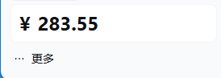

# dsh-usage-wallet

给 **DeepSeek Harness（DSH）Web UI** 用的侧边栏插件（[`dougen/dsh-deepseek-usage`](https://github.com/dougen/dsh-deepseek-usage) 的非官方分支）。

除了原版全部能力，这个分支新增两家「模型 Key 查不到、必须走控制台」的账户读数：

- **`qwen-token-plan`（阿里云百炼 / Qwen Token Plan）**：显示阿里云账户的**代金券余额**（BSS OpenAPI + AccessKey）；
- **`mimo` / `xiaomimimo`（小米 MiMo）**：显示 MiMo 控制台的**账户余额**（可选带 Token Plan 月度用量）。



## ⚠️ 装完不显示卡片 / 看不到 AccessKey 输入框？

`v0.16.0-qwen.1` ~ `qwen.3` 有两处遗留问题：

- 组件名写成了上游的 `@dougen/dsh-deepseek-usage`，DSH 会把它当成原版别名：插件显示「未运行」、侧边栏没有卡片（**qwen.3 修复**）；
- 浏览器端 bundle 的 `id` 与详情页的包名判断仍是上游名字，导致**详情页里不渲染「阿里云 AccessKey」输入框**（**qwen.4 修复**）。

**升级到 `v0.16.0-qwen.7`**：重跑最新的 `install.ps1`；或在插件页卸载后，「添加插件」填 `https://github.com/Yeoksin/dsh-usage-wallet`；然后完全重启 DSH。
排查清单见 [TROUBLESHOOTING.md](./TROUBLESHOOTING.md)。
## ⚠️ 从 0.16.0-qwen.1 升级（重要）

`0.16.0-qwen.1` 的 `install.ps1` 在 **Windows PowerShell 5.1** 下会把 profile 的 `package.json`
写成带 UTF-8 BOM 的文件，导致 DSH 启动时报：

```
Unexpected token '', "{"... is not valid JSON
```

**已经装过 qwen.1 的人**（DSH 打不开）：

```powershell
powershell -ExecutionPolicy Bypass -File .ix-bom.ps1
```

或者点崩溃窗口里的「Disable third-party plugins, back up profile patch, and restart」先把 DSH 启动起来。
`0.16.0-qwen.7` 改成无 BOM 字节写入 + 落盘后自检 + 失败自动回滚，不会再出现这个问题。

## 这个分支解决了什么问题

用 `qwen-token-plan` 这类阿里云百炼路由时，模型 Key（`sk-ws-…` / `sk-sp-…`）**只能调模型，查不到任何账户数据**——原版插件在卡片上只会显示「该提供商不支持查询」。

阿里云送的代金券余额在「费用与成本」的 **BSS OpenAPI** 后面，只能用**阿里云账号或 RAM 子账号的 AccessKey ID / Secret** 签名读取。本分支就是干这个：

- 调 `QueryCashCoupons`：把所有 `Status=Available` 的代金券余额加总；
- 如果一张可用代金券都没有，回落调 `QueryAccountBalance`：显示账户可用额度（现金 + 信控）；
- 结果就是侧边栏卡片上的 `¥金额`，每 30 秒自动刷新，点卡片立即刷新。

顺带修了上游一个 bug：`POST /api/deepseek-usage/token` 在真实 HTTP 下必定返回 413（读请求体的写法与 DSH webServer 的 `node:http` 接口不匹配），所以**原版插件的 OAuth 令牌/AK 保存功能实际不可用**。本分支已修复。

### 小米 MiMo：两种输入，各管一件事

| 输入 | 能读到什么 | 为什么 |
| --- | --- | --- |
| **API Key**（`sk-…` 按量 / `tp-…`、`ttp-…` Token Plan） | 校验 Key 是否有效、属于哪个集群、能调哪些模型 | MiMo 推理网关**没有**任何账户/余额接口：`/v1/models` 之外的路径（`/v1/balance`、`/v1/usage`、`/v1/billing/…`）实测全部 404，官方文档也只把余额放在控制台。 |
| **控制台 Cookie** | 账户余额（¥）、可选的 Token Plan 月度用量百分比与周期结束时间 | 余额与套餐用量在 `platform.xiaomimimo.com/api/v1/…`，需要登录态 Cookie（`api-platform_serviceToken` + `userId`）。 |

所以侧边栏的 MiMo 卡片由「Cookie」决定数值：填了 Cookie 才会出现余额与套餐百分比；API Key 只用来确认「这把 Key 能用」，不会伪造任何金额。
### 小米 MiMo：为什么需要 Cookie

MiMo 开放平台和阿里云一样，**推理 Key 查不到余额**：

- 按量计费的 Key 是 `sk-…`，Token Plan 的 Key 是 `tp-…`，两者都只能调模型；
- 账户余额与套餐用量在控制台自己的 JSON API 后面（`platform.xiaomimimo.com/api/v1/…`），需要浏览器登录态里的 Cookie：`api-platform_serviceToken` 与 `userId`。

**怎么填**：

1. 浏览器登录 <https://platform.xiaomimimo.com>，打开「账户余额」页；
2. `F12` → **Network** → 任选一个 `api/v1/...` 请求 → 复制请求头里的整行 **Cookie**；
3. DSH → 设置 → 插件 → 本插件详情页 →「**小米 MiMo 控制台 Cookie**」→ 粘贴 → 保存。

保存后宿主会立刻请求一次余额，把结果（`已保存 · ¥xx` 或具体失败原因）直接显示在页面上。Cookie 只存在本机凭据库（`MIMO_COOKIE`），不会回传浏览器、也不会发往任何第三方；插件只请求 `platform.xiaomimimo.com`。

> Cookie 会随登录过期。过期后插件会提示「小米 MiMo 登录状态已过期」，重新登录并复制一次即可。注意别把 Cookie 发给别人——它等同于你的控制台登录凭证。
## 安装

**一键安装（Windows，推荐）**：到 [Releases](https://github.com/Yeoksin/dsh-usage-wallet/releases/latest) 下载 `install.bat` 和 `install.ps1`，放在同一目录双击 `install.bat`，然后完全重启 DSH。脚本会自动下载、解压、并改好 `dsh.profile.bundles`。

详细步骤（含手动安装、卸载、网络不通时的离线参数）见 [INSTALL.md](./INSTALL.md)。

DSH 的插件目录是 `~/.dsh/profiles/desktop/node_modules/`。任选一种：

### 方式 A：git clone（推荐，方便更新）

```bash
cd ~/.dsh/profiles/desktop/node_modules
git clone https://github.com/<你的用户名>/dsh-usage-wallet.git
```

然后在 `~/.dsh/profiles/desktop/package.json` 的 `dependencies` 里加一行（或直接写 `"file:./node_modules/dsh-usage-wallet"`）：

```json
"dsh-usage-wallet": "file:node_modules/dsh-usage-wallet"
```

并把包名加进 `dsh.profile.bundles` 数组末尾：

```json
"bundles": [ "…", "@dougen/dsh-deepseek-usage"  →  改成 "dsh-usage-wallet" ]
```

> ⚠️ **不要同时启用原版和本分支**：两者注册相同的路由（`/api/deepseek-usage`）与侧边栏槽位，会冲突。启用本分支前，先把原版 `@dougen/dsh-deepseek-usage` 从 `bundles` 里去掉。

### 方式 B：直接替换文件（最省事）

```bash
cd ~/.dsh/profiles/desktop/node_modules/@dougen/dsh-deepseek-usage
cp -r /path/to/dsh-usage-wallet/lib/* lib/     # 覆盖 3 个文件 + 新增 aliyun.js
```

等价于原版包原地升级，`package.json` 里的条目不用改。

### 方式 C：npm pack 后本地安装

```bash
npm pack                     # 产出 dsh-usage-wallet-0.16.0-qwen.7.tgz
```

然后把它当作本地 tarball 安装进 profile。

**改完后完全退出 DSH（托盘也退出）再打开**——宿主代码是启动时加载的。

## 配置：填阿里云 AccessKey

1. **创建一对 AccessKey**（给程序用的「账号密码」，免费）
   打开 <https://ram.console.aliyun.com/manage/ak>。建议：
   - 新建一个 **RAM 子用户**，勾选「使用永久 AccessKey 访问」；
   - 给这个用户授权系统策略 **`AliyunBSSReadOnlyAccess`**（只读访问费用与成本），**资源范围选「账号级别」**；
   - 复制 **AccessKey ID**（`LTAI` 开头）和 **AccessKey Secret**（只显示一次）。

   > 只读权限能看账单余额，不能买东西、不能改配置。即使泄露损失也有限；怀疑泄露就在 RAM 控制台禁用这对 Key。

2. **填进插件**
   「设置 → 插件 → 本插件详情页」拉到下方 **「阿里云 AccessKey（查代金券余额）」**：
   - AccessKey ID → 直接粘贴；
   - AccessKey Secret → 直接粘贴；
   - 点 **保存**。保存后会立刻自检：成功显示 `已保存 · ¥金额`，失败会写出具体原因：
     - 「AccessKey ID 不存在（可能已删除或禁用）」
     - 「AccessKey Secret 不正确（签名未通过）」
     - 「AccessKey 有效，但缺少费用与成本只读权限……」

3. 侧边栏底部卡片出现 `¥金额` 就成功了。

密钥只存在本机 DSH 凭据库（`~/.dsh/.credentials.yaml`）里的
`QWEN_TOKEN_PLAN_ACCESS_KEY_ID` / `QWEN_TOKEN_PLAN_ACCESS_KEY_SECRET` 两项，**不会发往浏览器，也不会发往任何第三方**；插件只会请求阿里云官方域名 `https://business.aliyuncs.com`。

### 也可以改用环境变量

不填表单也行，直接导出这两个环境变量（然后重启 DSH），插件会优先读它们：

```bash
export QWEN_TOKEN_PLAN_ACCESS_KEY_ID=LTAI…
export QWEN_TOKEN_PLAN_ACCESS_KEY_SECRET=…
```

也认 `ALIBABA_CLOUD_ACCESS_KEY_ID` / `ALIBABA_CLOUD_ACCESS_KEY_SECRET`（阿里云 SDK 的通用命名）。

## 支持的提供商

| 提供商（路由 id） | 类型 | 数据来源 | 凭据引用 |
| --- | --- | --- | --- |
| **Qwen Token Plan / 阿里云百炼（`qwen-token-plan`）** | **余额** | **`QueryCashCoupons` → `QueryAccountBalance`（阿里云 BSS OpenAPI）** | **`QWEN_TOKEN_PLAN_ACCESS_KEY_ID` + `…_ACCESS_KEY_SECRET`** |
| **Xiaomi MiMo（`mimo`、`xiaomimimo`）** | **余额 + 套餐用量** | **`GET https://platform.xiaomimimo.com/api/v1/balance`（+ `/tokenPlan/usage`）** | **`MIMO_COOKIE`（控制台 Cookie）** |
| DeepSeek（`deepseek-official`、`deepseek-account`、`deepseek`） | 余额 | `GET https://api.deepseek.com/user/balance` | `DEEPSEEK_API_KEY` |
| Moonshot / Kimi（`moonshotai`） | 余额 | `GET /v1/users/me/balance` | `MOONSHOTAI_API_KEY` / `MOONSHOT_API_KEY` |
| Z.ai / GLM（`zai`） | 余额 | `GET /api/biz/account/query-customer-account-report` | `ZAI_API_KEY` |
| OpenRouter（`openrouter`） | 余额 | `GET /api/v1/key`（无 Key 限额时回落 `/api/v1/credits`） | `OPENROUTER_API_KEY` |
| Kimi For Coding（`kimi-coding`） | 订阅用量 | `GET https://api.kimi.com/coding/v1/usages` | `KIMI_CODING_API_KEY` |
| OpenCode（`opencode`、`opencode-go`） | 订阅用量 | `GET https://opencode.ai/zen/go/v1/usage` | `OPENCODE_API_KEY` |
| MiniMax（`minimax`、`minimax-cn`） | 订阅用量 | `GET /v1/token_plan/remains` | `MINIMAX_API_KEY` / `MINIMAX_CN_API_KEY` |
| Claude Code（`anthropic`） | OAuth 订阅 | `GET https://api.anthropic.com/api/oauth/usage` | `DSH_USAGE_CLAUDE_OAUTH_TOKEN` |
| OpenAI Codex（`openai-codex`） | OAuth 订阅 | `GET https://chatgpt.com/backend-api/wham/usage` | `DSH_USAGE_CODEX_OAUTH_TOKEN` + `…_ACCOUNT_ID` |

## 常见问题

**保存后提示「AccessKey 有效，但缺少费用与成本只读权限」**
RAM 控制台 → 身份管理 → 用户 → 该用户 → **权限管理 → 个人权限 → 新增授权** → 资源范围 **账号级别** → 系统策略 **`AliyunBSSReadOnlyAccess`**。注意别选成名字很像的 `AliyunSLBReadOnlyAccess`（那是负载均衡）。

**余额显示 `¥0.00`**
Key 与权限都正常，但这个账号当前没有可用代金券（券过期/已用完），同时账户可用额度也是 0。可以到阿里云控制台「费用与成本 → 卡券」核对。

**想看的是 Token Plan 套餐的月度用量百分比，而不是代金券金额**
本分支目前只做了代金券/账户余额（走 BSS OpenAPI，AK/SK 就能读）。套餐用量在百炼控制台网关后面，需要先用 AK/SK 换 console token（`GenerateCLIAccessToken`），欢迎 PR。

**卡片空白，提示「未配置阿里云 AccessKey ID / Secret」**
就是还没填 AK/SK——模型 API Key 查不到代金券余额，这是阿里云的接口设计，不是插件问题。

**非阿里云路由的余额/用量读不到**
先看插件详情页的「余额与用量查询状态」页：每个提供商一张卡，会写明是没配密钥、接口失败还是该方法不适用。排查原版行为请看 [`README.upstream.md`](./README.upstream.md)。

## 与上游同步

本分支基线是上游 `v0.16.0`。上游更新后：

1. `node scripts/sync-upstream.mjs <版本>` 取回新的基线源码；
2. 把本分支的三处补丁重新应用到新基线上（改动点见 [NOTICE.md](./NOTICE.md) 的表格；锚点都在 `lib/` 里，逐条对照即可）；
3. `npm test` 全绿后再发版。

## 开发

没有构建步骤，`lib/*.js` 直接就是运行时文件。

```bash
npm test          # node --test，覆盖签名/解析/路由/客户端
```

测试里有两条值得注意：

- `test/aliyun.test.mjs`：用阿里云官方文档给出的 RPC 签名示例向量验证签名实现（AK=testid、SK=testsecret → `OLeaidS1JvxuMvnyHOwuJ+uX5qY=`）；
- `test/plugin-host.test.mjs`：真起一个 `node:http` 服务器，跑通「POST 保存 AK/SK → 主卡片读到余额 → 状态页列出行」，就是为了防住上游那个 413 的坑。

## 许可

MIT。原插件版权归 [dougen](https://github.com/dougen)，见 [LICENSE](./LICENSE) 与 [NOTICE.md](./NOTICE.md)。